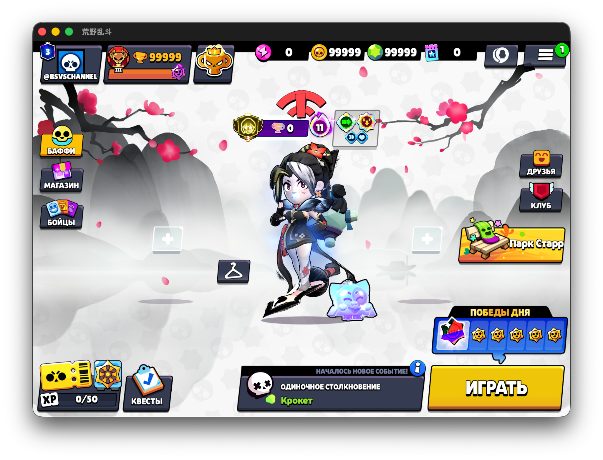

**Русский** | [English](README_EN.md)

---

# BSVS — Brawl Stars China v69

**Первый open-source релиз BSVS для китайской версии Brawl Stars (CN v69)!**


> **BSVS CN v69** — неофициальный приватный сервер для китайской версии Brawl Stars. Это первый открытый релиз проекта: исходный код доступен всем, кто хочет изучать устройство сервера, вносить улучшения и развивать его вместе с сообществом.

## Скриншот

<p align="center">
  
</p>

*Главный экран клиента Brawl Stars CN v69, подключённого к BSVS.*

## О проекте

BSVS создаётся для энтузиастов **Brawl Stars China**, которым интересно исследовать серверную часть игры и экспериментировать с собственными сборками. Проект написан на **Python** и ориентирован на совместимость с клиентом **CN v69**.

В текущем релизе можно подключить клиент к серверу, войти в профиль и открыть главное меню. Код проекта открыт для изучения, собственных дополнений и совместной разработки.

Это **первый open-source релиз BSVS CN v69**. Мы будем рады участникам, которые помогут сделать проект лучше!

## Клиенты (iOS/ANDROID)

[IPA (Google Drive)](https://drive.google.com/file/d/1eAK-HBi5Qo3dOUWGPS9Pprc7yHTWCdlU/view?usp=sharing)
[APK (Google Drive)](https://drive.google.com/file/d/1eK-FdlkO7AlOh0FOuSx6B6dGLCsup5gk/view?usp=sharing)

## Как запустить

**Требуется:** Python 3.10+ и совместимый клиент Brawl Stars CN v69.

1. Скачайте исходники проекта.
2. Откройте терминал в папке с файлом `Core.py`.
3. Запустите сервер:

   ```bash
   python Core.py
   ```

4. Подключите совместимый клиент к IP вашего сервера и TCP-порту `9339`.

Способ настройки подключения зависит от используемой сборки клиента.

## Будущее проекта

Это только начало. Мы планируем совершенствовать совместимость с CN v69, развивать возможности сервера и принимать улучшения от сообщества.

## Open source и сообщество

**BSVS CN v69 открыт для разработчиков и энтузиастов!**

- Поставьте звезду репозиторию, если проект вам интересен.
- Сообщайте о проблемах через **Issues**.
- Предлагайте улучшения и отправляйте **Pull Requests**.
- Делитесь идеями и помогайте развивать проект.

**Лицензия:** перед распространением исходников укажите лицензию в файле `LICENSE` и убедитесь, что у вас есть права на публикацию включённых материалов.

## ⚠️ Disclaimer

BSVS — независимый неофициальный фанатский проект. Он не связан с Supercell или Tencent. Название Brawl Stars и связанные игровые материалы принадлежат их правообладателям.

---

<p align="center"><strong>BSVS CN v69 — первый открытый релиз. Развиваем вместе!</strong></p>
